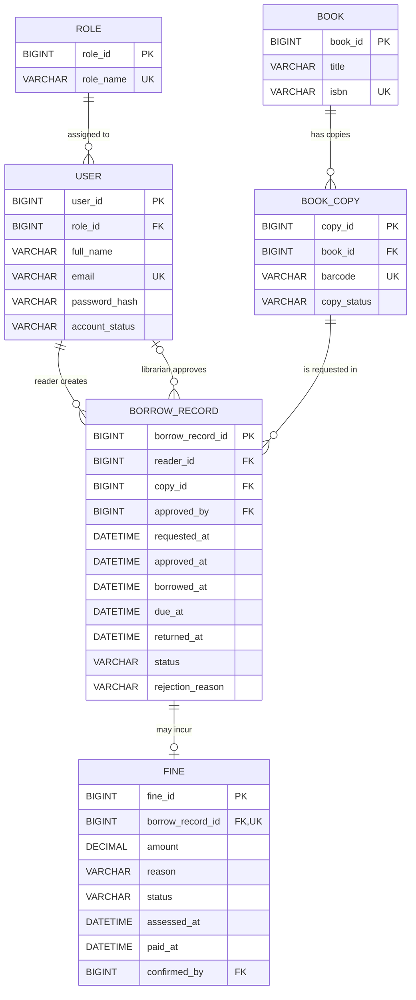

# ERD — BorrowRecord / Fine

## Sơ đồ

## Bảng và thuộc tính trọng tâm

### `BorrowRecord`
- `borrow_record_id`: PK, mã phiếu mượn.
- `reader_id`: FK đến `User.user_id`, người yêu cầu mượn.
- `copy_id`: FK đến `BookCopy.copy_id`, bản sao được mượn.
- `approved_by`: FK nullable đến `User.user_id`, thủ thư duyệt yêu cầu.
- `requested_at`: thời điểm gửi yêu cầu.
- `approved_at`: thời điểm duyệt.
- `borrowed_at`: thời điểm giao sách thực tế.
- `due_at`: hạn phải trả, được thiết lập khi giao sách.
- `returned_at`: thời điểm nhận lại sách; `NULL` khi chưa trả.
- `status`: trạng thái nghiệp vụ.
- `rejection_reason`: lý do từ chối, nullable.

### `Fine`
- `fine_id`: PK.
- `borrow_record_id`: FK + UNIQUE, bảo đảm tối đa một khoản phạt cho mỗi record trong mô hình này.
- `amount`: số tiền phạt, `DECIMAL(12,2)`, không dùng `FLOAT`.
- `reason`: lý do phạt (ví dụ `LATE_RETURN`, `DAMAGED_BOOK`, `LOST_BOOK`).
- `status`: `UNPAID`, `PAID`, hoặc `WAIVED`.
- `assessed_at`: thời điểm ghi nhận khoản phạt.
- `paid_at`: thời điểm thanh toán, nullable khi chưa thanh toán.
- `confirmed_by`: thủ thư xác nhận thanh toán/miễn phạt, nullable.

## Quan hệ và lực lượng
- `User (reader) 1 — 0..N BorrowRecord`: một độc giả có thể có nhiều phiếu; mỗi phiếu thuộc một độc giả.
- `User (librarian) 0..1 — 0..N BorrowRecord`: một thủ thư có thể duyệt nhiều phiếu; phiếu chờ duyệt chưa có người duyệt.
- `BookCopy 1 — 0..N BorrowRecord`: một bản sao có lịch sử mượn nhiều lần; mỗi record tham chiếu một bản sao.
- `BorrowRecord 1 — 0..1 Fine`: record có thể không bị phạt hoặc có tối đa một khoản phạt.

## Ràng buộc nghiệp vụ cần thực hiện ở Service/Transaction
1. Chỉ độc giả có tài khoản hợp lệ mới gửi yêu cầu.
2. Chỉ thủ thư/Admin được duyệt, từ chối hoặc xác nhận thanh toán.
3. Không cho mượn một bản sao nếu đang có record ở trạng thái `BORROWING` hoặc chưa được trả; cần kiểm tra và cập nhật trong cùng transaction để tránh race condition.
4. Khi duyệt yêu cầu, kiểm tra bản sao vẫn sẵn sàng; khi giao sách thì đặt `borrowed_at` và `due_at`.
5. Khi trả sách, đặt `returned_at`, chuyển trạng thái phù hợp, tính tiền phạt nếu trả trễ và cập nhật trạng thái `BookCopy`.
6. Không xóa cứng lịch sử mượn/phạt; ưu tiên giữ lịch sử.
7. Nếu cho phép nhiều khoản phạt trên một phiếu (phạt trễ + hỏng sách), bỏ UNIQUE trên `Fine.borrow_record_id` và đổi thiết kế sang `Fine` 1:N `BorrowRecord`.

## Quyết định cần nhóm xác nhận
- Một phiếu có một bản sao hay nhiều bản sao? Bản này chọn một bản sao/record để đơn giản hóa.
- Tên bảng user thực tế là `User`, `Users`, `Account` hay `users`? Đồng bộ với phần Huy.
- `BookCopy` đã có trong ERD phần Thông chưa? Nếu có, tái sử dụng đúng tên/cột.
- Quy định số tiền phạt/ngày và số ngày mượn do nhóm thống nhất; bản này không tự áp đặt mức tiền cụ thể.
