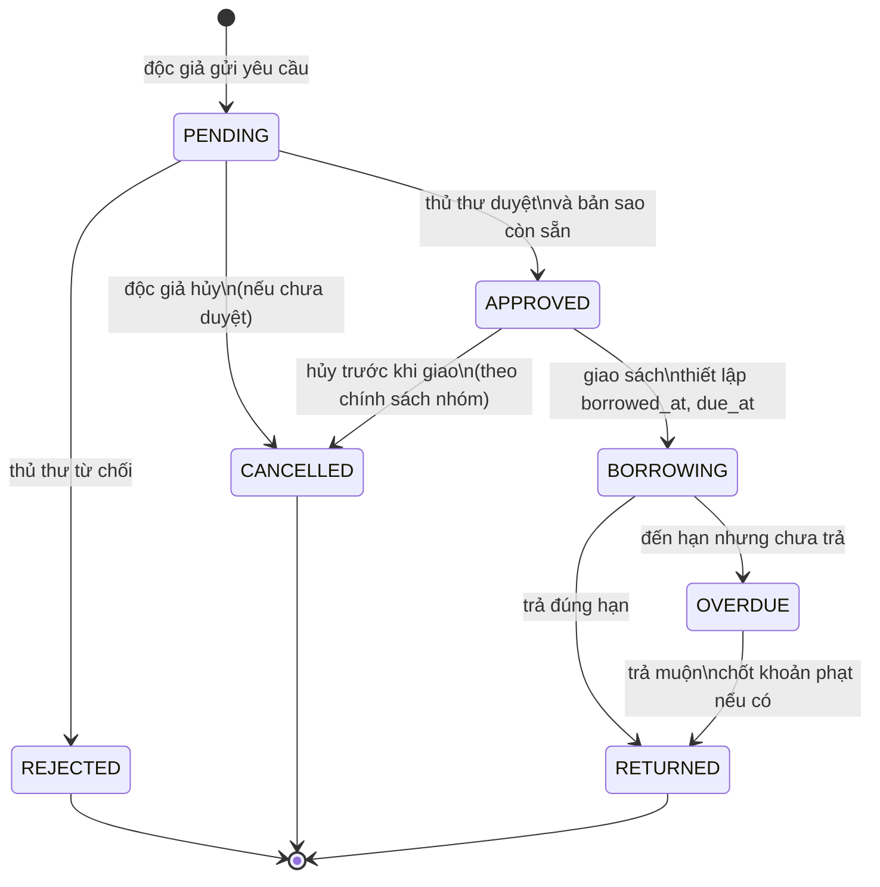
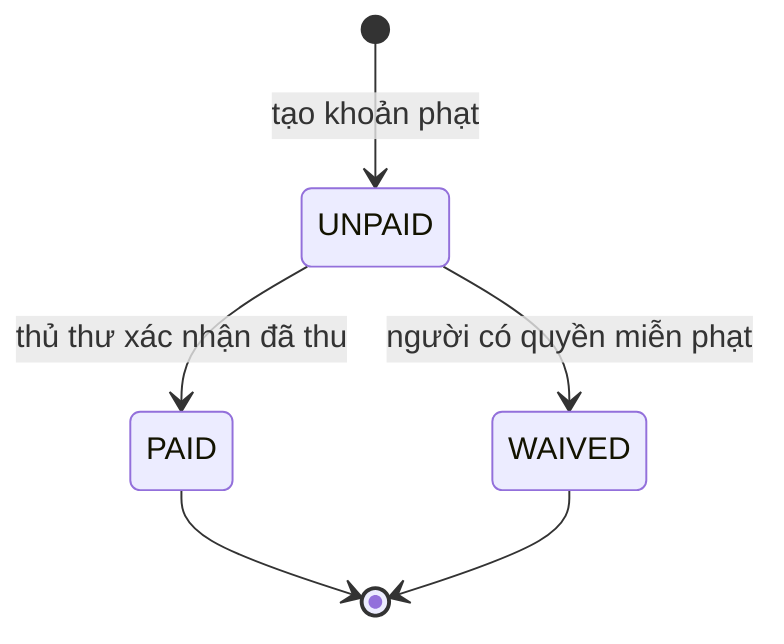

# State Machine — BorrowRecord

## Sơ đồ trạng thái

## Ý nghĩa trạng thái

| Trạng thái | Ý nghĩa |
|---|---|
| `PENDING` | Độc giả đã gửi yêu cầu, đang chờ thủ thư xử lý |
| `APPROVED` | Yêu cầu đã được duyệt nhưng sách chưa chắc đã được giao |
| `REJECTED` | Yêu cầu bị từ chối |
| `CANCELLED` | Yêu cầu bị hủy trước khi hoàn tất giao sách |
| `BORROWING` | Sách đã giao cho độc giả, chưa trả |
| `OVERDUE` | Đã quá hạn và sách vẫn chưa được trả |
| `RETURNED` | Sách đã được trả và hoàn tất record |

## Chuyển trạng thái và điều kiện

| Từ → Đến | Ai/điều kiện | Dữ liệu cần cập nhật |
|---|---|---|
| `PENDING → APPROVED` | Thủ thư; tài khoản và bản sao hợp lệ | `approved_by`, `approved_at`, `status` |
| `PENDING → REJECTED` | Thủ thư | `approved_by`, `approved_at`, `rejection_reason`, `status` |
| `PENDING → CANCELLED` | Độc giả tạo yêu cầu; chưa duyệt | `status` |
| `APPROVED → BORROWING` | Thủ thư xác nhận giao sách | `borrowed_at`, `due_at`, `status`; cập nhật bản sao |
| `APPROVED → CANCELLED` | Chưa giao sách, theo chính sách nhóm | `status`; giải phóng giữ chỗ nếu có |
| `BORROWING → OVERDUE` | `NOW() > due_at` và chưa trả | cập nhật trạng thái hoặc tính động khi truy vấn |
| `BORROWING → RETURNED` | Trả trước/đúng hạn | `returned_at`, `status`; cập nhật bản sao |
| `OVERDUE → RETURNED` | Trả sau hạn | `returned_at`, `status`; tính và ghi nhận Fine nếu có |

## State machine cho Fine

`UNPAID`, `PAID`, `WAIVED` là trạng thái khoản phạt, không phải trạng thái của `BorrowRecord`.

## Quy tắc triển khai
- Không cho chuyển `REJECTED`, `CANCELLED`, `RETURNED` quay lại `BORROWING`.
- Mọi thay đổi trạng thái cần kiểm tra trạng thái hiện tại ở tầng Service.
- Các thao tác duyệt/giao/trả và cập nhật `BookCopy` cần nằm trong transaction.
- Không dựa hoàn toàn vào job nền để nhận biết quá hạn: mọi truy vấn danh sách đang mượn nên có thể xác định `due_at < NOW()` và `returned_at IS NULL`.
- Khi xác nhận trả, tính số ngày trễ theo chính sách nhóm (ngày lịch hay đủ 24 giờ), ghi số tiền vào `Fine.amount` và lưu thời điểm tính.
