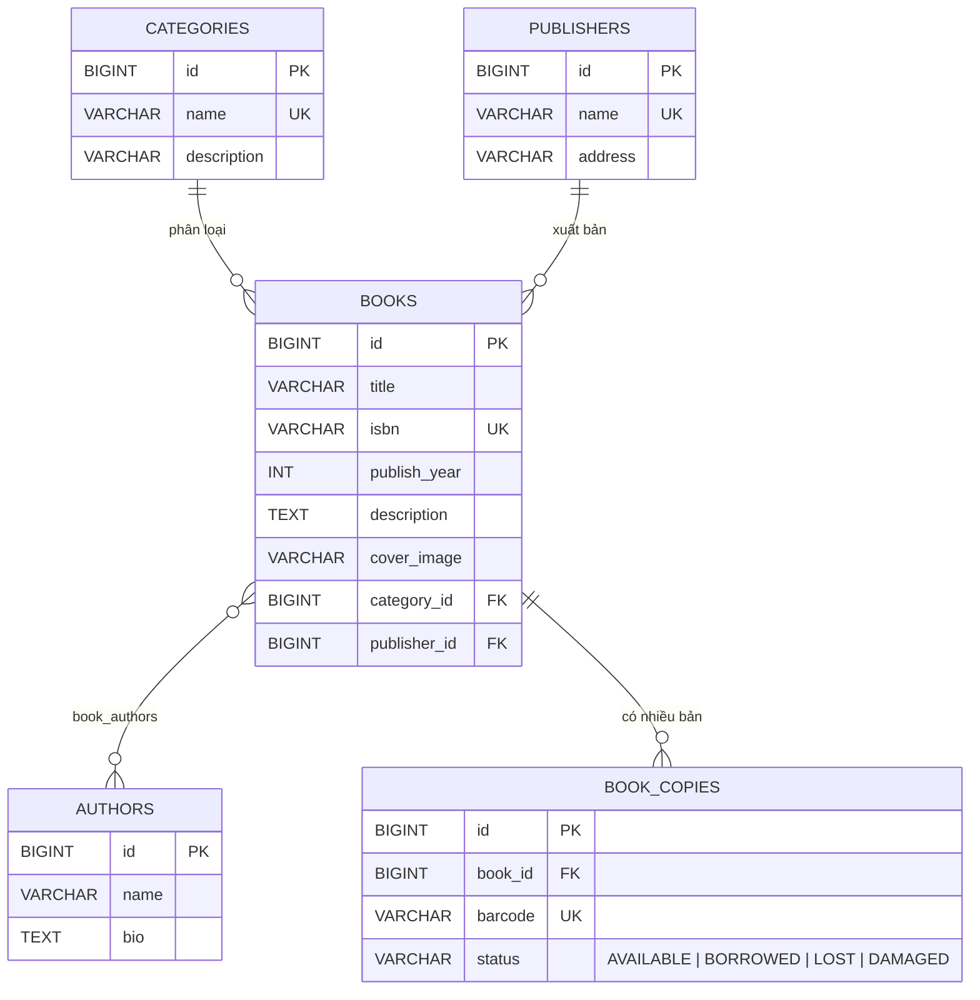

# ERD – Phần Sách

- **Book** là đầu sách (thông tin chung); **BookCopy** là từng cuốn vật lý, có mã vạch riêng.
- Số lượng còn lại của một sách = số BookCopy có `status = AVAILABLE`.
- Phần Mượn/Trả sẽ tham chiếu `book_copies.id` và đổi trạng thái AVAILABLE <-> BORROWED.
